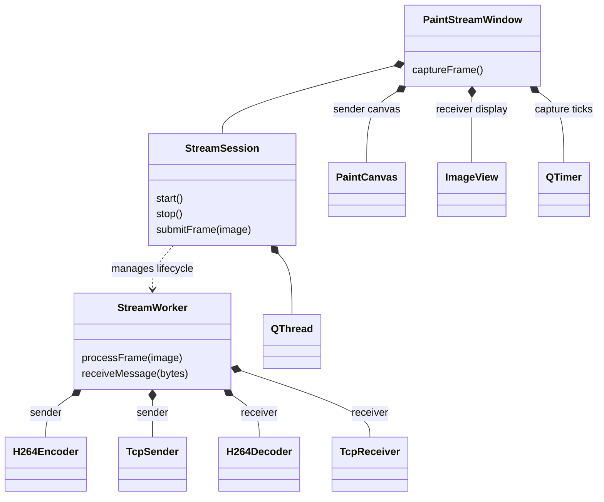
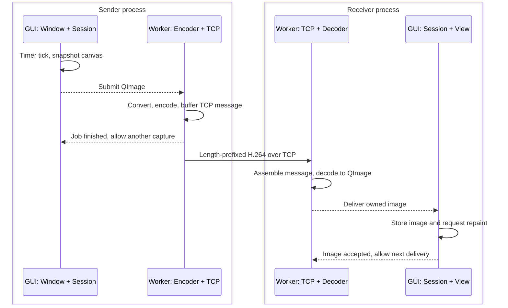

# PaintShare

Draw in a Qt window and stream the bitmap to another process using
Cisco OpenH264 and TCP. C++23, Qt 6, fixed 960 × 540 canvas, 15 fps.

## Build and run

On macOS, install Xcode Command Line Tools and Homebrew, then:

```sh
brew install cmake qtbase
bash codec/scripts/build-openh264.sh
cmake -S . -B build -DCMAKE_PREFIX_PATH="$(brew --prefix qtbase)" \
    -DBUILD_H264_ENCODER=ON
cmake --build build -j 4
```

The script builds OpenH264 v2.7.0 locally in `codec/.deps/`.
The compiler and standard library must support C++23 `std::expected`.

Start the receiver first, then the sender in another terminal:

```sh
./build/paint-stream --mode receive
./build/paint-stream --mode send
```

Draw with the left mouse button; **Clear** resets the canvas. Use the connection
button to stop/restart a session. After a connection error, stop the old session
before reconnecting. A sender disconnect leaves the receiver listening.

Both default to `127.0.0.1:5000`. For two computers, bind the receiver with
`--host 0.0.0.0` and give the sender `--host <receiver-ip>`.
Use `--port <number>` to change the port. This prototype uses plain TCP and
supports one receiver, fixed dimensions, manual reconnect, and no audio.

## Classes

The window handles interaction; the session manages the thread boundary;
the worker runs the codec and networking. Sender and receiver use different
branches of the same classes.



## Threads and one frame's journey

Each process has a GUI thread and one worker thread. Widgets and snapshots
stay on the GUI thread; conversion, codecs, and sockets stay on the worker.
Dashed arrows below are queued notifications between threads.



Only one capture job can be outstanding. A busy worker or full TCP buffer
causes raw captures to be skipped before encoding. The receiver decodes frames
in order but keeps only the latest image waiting for display. Notifications
mean local processing completed, not that the remote window has repainted.

Start reading at [the window](src/paint_stream_window.cpp), then
[the session](src/stream_session.cpp) and [the worker](src/stream_worker.cpp).

## Tests and learning prototypes

```sh
ctest --test-dir build --output-on-failure
```

Six suites cover transport, encoding, decoding, threaded sessions, GUI behavior,
and streaming between separate processes. A cross-computer LAN check is manual.

The smaller `paint-share` (painting and PNG export) and `image-transfer` (PNG over
TCP) executables remain available. They build without OpenH264 when configured
with `-DBUILD_H264_ENCODER=OFF`. See [codec/README.md](codec/README.md) for the
standalone codec experiment.

For Neovim, CMake generates `build/compile_commands.json`; `.clangd` uses it.
After configuring, run `:LspRestart clangd` if needed. If you change the build
directory, update `.clangd` to match.
